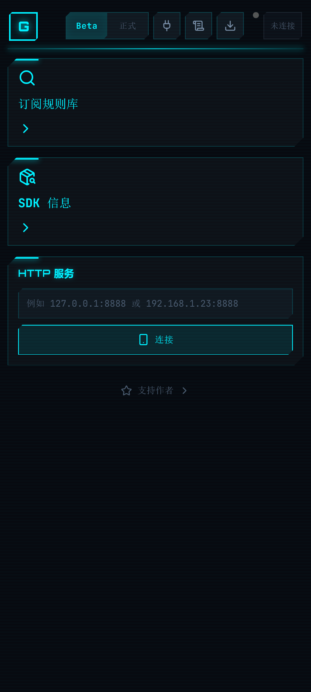
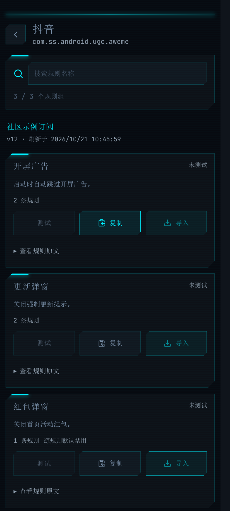

# GKD Rule Studio

一款运行在手机上的 GKD 规则制作工具：连接 GKD 的 HTTP 服务，在界面截图上选控件，自动生成、验证、测试并交付规则。目标是把“看节点树、写 selector、改 JSON5、反复试规则”压缩成一条可视化工作流。

[](LICENSE)
[](android/README.md)
[](docs/verification/gkd-release-channels.md)

> **当前分支范围：** 本分支是 Android 版发行准备，不包含“扫描已安装应用的 SDK”与 MCP；桌面版代码仍保留，但当前以 Android 版为准。分支关系见 [发行范围记录](docs/verification/branch-split-2026-11-03.md)。

<p align="center">
  
  
</p>

## 它能做什么

| 场景 | 能力 |
| --- | --- |
| 自己写规则 | 连接 GKD、读取快照、截图上拖动选点、自动生成候选 selector、验证命中并复制/导入 |
| 做连续操作 | 把多张快照编排成步骤，设置先后依赖，生成“点红包 → 返回 → 关闭弹窗”一类多步规则 |
| 找现成规则 | 添加多个 GKD 订阅源，按应用名或包名搜索，复制完整规则组，或连接 Beta 后直接导入 |
| 用 AI 辅助 | 复制带完整上下文的求助 Prompt；也可配置 OpenAI 兼容接口，在 App 内直接生成、测试和迭代规则 |
| 反馈 | 在首页、工作区或测试结果页提交反馈；可附带脱敏截图、节点、规则文件和 GKD 诊断压缩包 |

基础制作流程不需要 API Key，也不需要账号。只有内置 AI、订阅首次下载和检查更新需要联网。

## 完整功能

### 1. GKD 连接与快照

- 支持输入 `127.0.0.1:8888`、`192.168.1.23:8888` 或完整 `http://` 地址连接 GKD HTTP 服务。
- 首页区分官方 GKD「正式版」与「测试版」，首次默认正式版；连接时按包名和 `versionName` 共同核对，错渠道会明确提示。
- 读取设备快照列表和截图；可刷新、单张打开或多张勾选进入工作区。
- 可为快照设置本地名称，名称会用于列表显示和导出文件。
- 支持导出单张快照为 Markdown 节点树 + 原格式截图，截图按文件头识别 PNG/WebP。
- 支持 Android 23 及以上；GKD 连接允许局域网明文 HTTP，这是为了访问手机本机的 GKD 服务。

### 2. 从选点到候选规则

- 在截图画布上**拖动放大镜**到目标控件，松手后定位节点；不依赖手写坐标。
- 支持切换父节点、可点击祖先和重叠节点，避免只选到文字层或广告热区。
- 内置 14 类 selector 策略，覆盖精确 `id/vid/desc`、类型加属性、文本上下文、父节点、兄弟关系、容器兜底等常见写法。
- 自动验证候选在当前快照中的命中数、实际点击节点和支持节点，并在画布上区分选中框与命中框。
- 根据稳定性、唯一性、点击风险、广告遮挡和倒计时文本等因素排序，给出首选、风险提示和修复建议。
- 能识别常见广告 SDK 的节点特征和跳过按钮命名，用于当前快照的风险判断；不会扫描手机里安装了哪些 App。

### 3. 场景、规则编辑与交付

- 内置 9 种规则场景：开屏广告、页面弹窗、视频内广告、随机插屏、切回前台广告、信息流广告、更新弹窗、权限/通知/评价弹窗和通用功能。
- 每种场景会生成对应的 `groupName`、`activityIds`、`matchTime`、`actionMaximum`、`actionCd`、`resetMatch` 等默认参数，仍可继续调整。
- 可用自然语言描述特殊场景，复制场景 Prompt 给外部 AI，再把 AI 返回的 JSON5 粘回 App 保存为自定义场景。
- 提供条件编辑器，可查看和修改文字、描述、ID、属性、父子/兄弟等条件，并重新验证编辑后的完整规则。
- 支持复制完整 JSON5、查看规则摘要和交付预览，保留规则组公共字段、规则编号及引用信息。
- 正式版路径复制后手动添加到 GKD；官方 GKD 1.13 Beta 可通过 `/api/appendRules` 直接追加到本地规则。

> Beta 的追加接口不是幂等操作。同一规则组重复导入会追加副本；若请求响应丢失，应先到 GKD 核对是否已经写入，再决定是否重试。

### 4. 单步与多步工作区

- **单步模式**：一张快照、一处选点，集中生成和测试一条规则。
- **多步模式**：从多张快照创建步骤，支持步骤排序、改名、说明、切换快照、改绑快照和单独设置场景。
- 每一步保留自己的候选和选中规则；后续步骤可依赖前面步骤，未选规则的步骤会提示并按既定规则跳过。
- 可预览和复制整个多步规则组，也可把整套流程加入当前测试集合后发送到 GKD。
- 支持在单步、多步和多张快照之间切换，便于对连续弹窗或页面跳转做联合验证。

### 5. 测试与导入

- 同一控件可以加入多条候选同时测试，在 GKD 中触发一次，再对比哪条规则命中最准确。
- 统一记录“测试中 / 已测试 / 有效 / 无效 / 已结束”等状态，支持重新测试、结束、删除和再次同步。
- 测试集合通过 GKD 内存订阅发送；修改后会同步当前集合，避免只停止界面记录而设备仍运行旧测试。
- 测试有效后，正式版复制规则；Beta 可将规则组直接写入 GKD 本地规则。
- 测试记录按控件、规则内容和 AI session 隔离，修改 action、scope 或候选后会重新计算，不沿用旧测试结果。

### 6. 订阅规则库

- 支持添加多个 GKD 订阅来源，并校验订阅地址、订阅 ID、版本和数据结构。
- 订阅按来源缓存到本地；刷新失败时保留旧缓存，重启或断网仍可搜索和复制。
- 可按应用名称或包名搜索，跨来源聚合同一应用，但不会擅自合并不同来源的规则组。
- 逐组查看原名称、说明、规则数量、默认启用状态和规则原文。
- 复制时保留完整应用信息、规则组字段、规则引用和来源标注；默认禁用的组仍是禁用状态。
- 可直接把规则组加入测试集合；连接对应 GKD 渠道后测试并记录结果。Beta 支持直接导入。
- 导入的是固定副本，不随原订阅自动更新；更新订阅后需要重新选择并导入。

### 7. 外部 AI 与内置 AI

**外部 AI Prompt**

- 生成包含应用、快照、当前控件、节点树上下文、场景参数和 GKD selector 约束的结构化 Prompt。
- 可复制单步或多步 Prompt 到 ChatGPT、Claude、Kimi 等工具，再把回复粘回 App 自动提取合法规则。
- 测试失败后可汇总多条反馈，生成包含失败现象、静态验证、已知限制和修复建议的反馈 Prompt。

**内置 AI**

- 支持 OpenAI Chat Completions 兼容接口，可配置 Base URL、API Key、模型、温度、超时和多模态能力。
- 支持保存多个模型配置并切换；可测试连接，并区分配置错误、鉴权、网络、HTTP、超时和解析错误。
- 可把截图作为多模态输入；模型不支持图片时会尝试退回纯文本节点上下文。
- 生成规则后可直接加入测试集、查看命中、填写测试反馈，再让 AI 进行下一轮修复。
- AI session 会冻结当次快照、Prompt 和候选上下文；单步与多步 session 分开管理。

> AI 配置保存在设备本地。当前实现使用 WebView `localStorage`，API Key 不是操作系统级密钥库加密；请不要在共用设备上保存长期密钥。

### 8. 反馈、隐私与诊断

- 首页和测试结果页都能发起「反馈」；渲染异常页也保留反馈入口，工作区不再单独放置入口。
- 自动整理 App 版本、系统版本、GKD 正式版/测试版及版本号、当前页面和相关错误，内容在提交前可预览、编辑。
- 当前规则可从 JSON、JSON5 或 TXT 文件读取，也保留直接粘贴和编辑；规则、截图、节点树默认不附带，需用户主动选择。
- GKD 测试版用户可按小字指引从「设置 → 诊断 → 诊断采集」导出 ZIP，再在反馈中手动上传；ZIP 原样附带并提示可能包含规则、节点文字和运行日志。
- 反馈分类包含工具故障、规则效果问题和「希望有的功能」。
- 截图支持框选不透明打码；与打码区域相交的节点文字会同步隐藏，已知 API Key 和用户填写的敏感词也会被替换。
- 发送失败会保留本地脱敏草稿，联网后可手动重试；同一反馈使用幂等键，减少重复提交。
- 联系方式选填，不需要账号。服务端默认保留反馈和附件 90 天。
- 内置调试日志记录网络、快照、选点、候选、AI、GKD 同步和错误，最多保留 500 条，可复制报告用于排查。

反馈服务是独立的 FastAPI + SQLite 后端，支持 Docker、Nginx HTTPS 反代、管理员后台、附件访问控制和定时清理；邮件提醒为可选功能，未配置 SMTP 时不会发送邮件。

### 9. 应用内更新

- App 内可检查新版本、下载 APK、校验 SHA256 并拉起系统安装。
- 更新清单读取 GitHub Release 的 `latest/download/update.json`，直连失败时自动尝试镜像。
- Android 端会再次校验下载文件，校验失败会删除临时文件。
- 本地和 CI 使用固定签名，保证覆盖安装的签名一致；发布前仍应核对版本、包名、签名和最终 APK 哈希。

## 快速开始

### 准备

1. 在 Android 手机上安装 GKD 和 Rule Studio APK。
2. 打开 GKD → 侧边栏 → HTTP 服务 → 启动服务。
3. 回到 Rule Studio，确认顶部选择的是“正式版”或“测试版”。
4. 输入地址。手机本机通常填 `127.0.0.1:8888`；连接另一台设备时填局域网地址。
5. 点“连接”，读取快照列表。

### 生成第一条规则

1. 勾选一张快照，进入工作区。
2. 在截图里把放大镜拖到广告关闭按钮或“跳过”按钮上，松手。
3. 如果选到了文字层而不是按钮，可在节点列表中切换父节点或可点击祖先。
4. 在「场景」选择最接近的预设；不确定时先用默认设置。
5. 在「候选」查看命中数、风险和首选建议，选一条加入测试。
6. 在目标 App 中触发广告，回到 Rule Studio 记录是否命中、是否误触、是否关闭成功。
7. 有效后：
   - 正式版：复制 JSON5，手动添加到 GKD 本地规则。
   - 测试版：连接官方 GKD 1.13 Beta 后直接导入本地规则。

### 做多步规则

1. 首页勾选多张快照进入工作区。
2. 切到“多步”，为每张快照创建或调整步骤。
3. 点步骤后在对应截图里选控件，分别生成候选。
4. 在「步骤」里设置名称、说明、场景、顺序和前置依赖。
5. 测试整套流程，确认每一步的点击和等待时间都符合实际界面。

## GKD 版本兼容

| 路径 | 当前面向版本 | 选择器引擎 | 快照 | 最终保存 |
| --- | --- | --- | --- | --- |
| 正式版（默认） | 官方 1.12.x | `@gkd-kit/selector` 0.5.23 | 支持 | 复制 JSON5 后手动添加 |
| 测试版 | 官方 1.13.0 Beta | `@gkd-kit/selector` 0.6.1 | 支持 | Beta 使用 `/api/appendRules` 直接追加 |

正式版和测试版可能使用相同的 `li.songe.gkd` 包名，因此不能只看包名；Rule Studio 会结合版本号判断渠道。旧 `.debug` 自改版不再作为官方测试版入口。

当前兼容范围以 [GKD 双路径验收记录](docs/verification/gkd-release-channels.md) 为准。若未来正式版升级到新选择器引擎，需要重新核对版本适配，不能只依据“正式版”标签推断。

## 哪些功能需要连接 GKD

| 功能 | 不连接 GKD | 连接正式版 | 连接 Beta |
| --- | --- | --- | --- |
| 浏览、搜索、复制缓存订阅 | 可用 | 可用 | 可用 |
| 读取快照、选点、生成候选 | 不可用 | 可用 | 可用 |
| 在设备上发送内存测试 | 不可用 | 可用 | 可用 |
| 复制规则 JSON5 | 不可用 | 可用 | 可用 |
| 直接写入 GKD 本地规则 | 不可用 | 不支持 | 可用 |
| 提交反馈 | 可用 | 可用 | 可用 |
| 使用外部 AI Prompt | 需要快照上下文，不能完整生成 | 可用 | 可用 |
| 使用内置 AI | 需要快照上下文，不能完整生成 | 可用 | 可用 |

## 离线、网络与隐私

- 选点、候选生成、静态验证、条件编辑和本地记录都在手机本地完成。
- 订阅缓存保存在本地；订阅刷新、内置 AI、更新检查和反馈提交需要网络。
- 连接 GKD 时使用局域网明文 HTTP，不应在不可信网络中暴露 GKD HTTP 服务。
- AI 请求直接发往用户配置的接口。API Key 保存在 WebView 本地存储，不进入项目仓库，但也不是硬件级密钥库。
- 反馈中的规则、截图和节点树默认不上传；只有用户在预览页主动确认的内容才会提交。
- 脱敏工具会处理已知密钥、用户敏感词、手动遮罩和相交节点，但它不是通用 PII 识别器，提交前仍应人工检查截图和文字。

## 开发

### 技术栈

- 前端：React 19、TypeScript、Vite 8、Vitest、JSON5
- 规则引擎：GKD Selector 0.5.23 / 0.6.1
- Android：WebView + Java Bridge、AGP 8.7.3、minSdk 23、compile/targetSdk 35
- 反馈服务：Python 3.12、FastAPI、Uvicorn、SQLite
- CI / 发布：GitHub Actions、pnpm、Gradle、GitHub Releases

### 环境

- Node.js：CI 使用 Node 24；Vite 8 要求 `^20.19.0 || >=22.12.0`
- pnpm 9
- JDK 17+，推荐 JDK 21
- Android SDK 35、Build Tools 35.0.0、platform-tools

### 常用命令

运行目录：仓库根目录；Shell：PowerShell。

```powershell
.\scripts\windows-pnpm.ps1 install --frozen-lockfile
.\scripts\windows-pnpm.ps1 dev
.\scripts\windows-pnpm.ps1 test
.\scripts\windows-pnpm.ps1 run typecheck
.\scripts\windows-pnpm.ps1 run build
```

入口先确认正在 Windows 上运行，再启动 pnpm。临时运行工具也用同一入口，例如 `.\scripts\windows-pnpm.ps1 exec vitest --version`。直接运行 `pnpm install` 或 `pnpm exec` 会跳过这一步；不要在 WSL 中复用本项目的 Windows 依赖目录。

`dev` 启动浏览器开发界面，默认地址为 `http://127.0.0.1:5174`。

### 构建 Android

运行目录：仓库根目录；Shell：PowerShell。

```powershell
.\scripts\windows-pnpm.ps1 run check:android-env
.\scripts\windows-pnpm.ps1 run test:android
.\scripts\windows-pnpm.ps1 run package:full
```

产物位置：

```text
android/app/build/outputs/apk/debug/app-debug.apk
```

`package:full` 会依次构建 Web 资源、运行 Java 单测、打包 APK 并输出 SHA256。仓库路径包含中文时，构建脚本会检查或复用约定的 ASCII 目录联接；详细说明见 [android/README.md](android/README.md)。

### 反馈后端

运行目录：`server/feedback`；Shell：PowerShell。

```powershell
python -m venv .venv
.\.venv\Scripts\python -m pip install -r requirements.txt
$env:FEEDBACK_DATA_DIR = (Join-Path $PWD 'data')
.\.venv\Scripts\python -m unittest discover -s tests -v
```

部署、环境变量、Docker、HTTPS 和后台管理说明见 [server/feedback/README.md](server/feedback/README.md)。

## 项目结构

```text
src/
  components/       Android 界面、截图画布、规则库、反馈和测试面板
  lib/              设备 API、选择器、候选生成、AI、流程和更新逻辑
  data/             场景参数、广告节点特征和风险词
android/            WebView 壳、Java Bridge、签名和 Gradle 构建
server/feedback/    FastAPI + SQLite 反馈服务
scripts/            构建、发布、更新检查和验收脚本
docs/               规格、研究、截图和验证记录
.github/workflows/  日常 CI 和 tag 发布流程
```

工作区入口为 `src/components/AndroidLiteApp.tsx`；前端只负责界面和业务逻辑，Android 原生层负责文件保存、剪贴板、更新下载、APK 安装和部分网络桥接。

## 发布

1. 更新 `package.json` 的 `version`。
2. 从 Windows PowerShell 运行 `./scripts/windows-pnpm.ps1 test`、`./scripts/windows-pnpm.ps1 run typecheck` 和 `./scripts/windows-pnpm.ps1 run package:full`。
3. 在真机完成正式版 / 测试版、快照、规则导入、反馈和更新链路验收。
4. 打 `vX.Y.Z` tag 并推送，Release workflow 会构建 APK、生成 `update.json` 并上传到 GitHub Release。
5. 发布后从 Windows PowerShell 运行 `./scripts/windows-pnpm.ps1 run check:update`，再核对 APK 的版本、包名、签名和 SHA256。

> `android/debug.keystore` 是保证覆盖安装可用的固定签名文件，不要删除或更换。本次发行版本为 `0.2.1`；安装前仍应核对 APK、`update.json` 和签名是否一致。

## 当前边界与已知限制

- 本分支不包含安装应用扫描、LibChecker 导入和 SDK 清单；仍保留的是对当前快照内广告节点特征的风险判断。
- 本分支不包含 App 内置 MCP 或 Node MCP；`.mcp.json` 只是开发时使用的 code-review-graph 配置。
- 不包含 ADB 功能和桌面版主动维护；桌面 Web 构建主要用于开发和验证 Android WebView 资源。
- 正式版不能直接写入本地规则，只能复制后手动添加；Beta 直接写入的追加接口可能产生重复规则。
- 反馈脱敏需要用户人工确认；当前验证记录仍要求覆盖“多个节点包含同一敏感值”和截图同步遮挡的场景。
- 发行前仍需要用真实 GKD、真实目标 App 和最终 APK 重新验收；自动测试不能代替实际点击效果。

更完整的待测项见 [v0.2.0 回归清单](docs/verification/release-v0.2.0-regression-checklist.md)。

## 参与贡献

这个项目最初是 vibe coding 产物，规则生成算法和 AI Prompt 仍在持续改进。欢迎提交：

- 新的候选 selector 策略或风险判断；
- 更稳定的 GKD 版本兼容实现；
- 订阅解析、规则编辑和测试流程的修复；
- 可复现的真实 App 快照与规则案例。

提交问题前，建议先复制工作区调试日志，并说明 GKD 版本、Android 版本、目标 App、快照 ID 和预期结果。不要在公开 Issue 中粘贴 API Key、账号密码、未经遮挡的截图或私人数据。

## 下载与相关链接

- [GitHub Releases](https://github.com/jjjj31/gkd-rule-studio/releases)
- [GKD 搞快点](https://github.com/gkd-kit/gkd)
- [GKD 订阅模板](https://github.com/gkd-kit/subscription)
- [GKD Discussions](https://github.com/orgs/gkd-kit/discussions)

## 开源协议

本项目使用 [SATA 协议（Star And Thank Author License）](LICENSE)。你可以自由使用、修改和分发；按照协议，请先给项目点一个 Star，并感谢作者。
