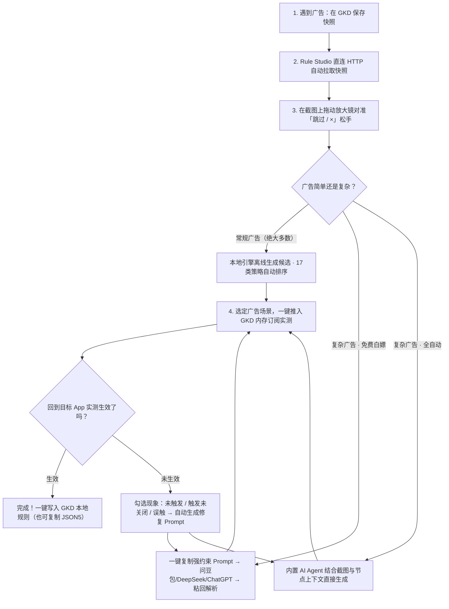

<div align="center">


# GKD Rule Studio

**不用学语法，在手机上拖动放大镜就能写 GKD 跳广告规则**

连接 GKD HTTP 服务，在截图上把放大镜拖到「跳过 / ×」松手，本地离线自动生成候选规则、一键推送 GKD 实测，并支持外部 / 内置 AI 闭环修复疑难广告。

[](https://github.com/jjjj31/gkd-rule-studio/releases)
[-3ddc84?style=flat-square)](android/README.md)
[](#详细功能清单与兼容性按需展开)
[](#离线网络与隐私)
[](LICENSE)

[下载安装包](https://github.com/jjjj31/gkd-rule-studio/releases) · [制作路线图](#规则制作路线图) · [为什么省时间](#为什么比手搓或直接问-ai-省心) · [3 分钟上手](#3-分钟快速上手) · [能力边界](#适用人群与坦诚说明) · [本地开发](#开发与构建)

</div>

<!--
  新版真机截图与动图就位后，放入 docs/images/ 并取消下方注释即可展示：
  <p align="center">
    
  </p>
  <p align="center">
    
  </p>
-->

---

## 这是给谁做的？

如果你符合下面任何一条，这个工具就是为你准备的：

- **手机广告太多**：开屏摇一摇、入页弹窗、信息流小叉叉烦不胜烦。
- **已经用上 GKD，但订阅没覆盖**：常用订阅库里没有你的小众 App，或 App 更新后老规则失效了。
- **想自己写规则，但不想啃语法**：看到节点树、selector 选择器、`JSON5` 就头大，只想指哪打哪。

> **核心承诺**：基础制作流程**完全运行在手机本地**，**不需要 API Key，不需要注册账号，免费开源**。只有使用内置 AI、拉取/刷新订阅、公告、检查更新与提交反馈时才会联网。

---

## 为什么比手搓或直接问 AI 省心？

真正在手机上操作一遍就会发现，真正劝退的不是写规则本身，而是**大量隐性折腾**：

| 环节 | 传统手搓 / 直接把快照发给 ChatAI | 使用 GKD Rule Studio |
| --- | --- | --- |
| **拿快照** | 导出快照压缩包，在手机文件管理器里翻半天上传 | 直连 GKD HTTP 服务，**自动拉取快照列表**，支持中文备注名 |
| **指明要点的位置** | 自己翻节点树，或打字解释“右上角那个小叉叉” | 截图上**拖动放大镜对准按钮松手**，自动锁定可点击节点 |
| **生成规则** | 要学 selector 语法；直接问 AI 容易胡编语法导致导入报错 | **本地引擎离线秒出候选**；复杂广告可一键复制**强语法约束 Prompt** 或用内置 AI |
| **真机测试** | 复制 → 切回 GKD → 粘贴进本地规则 → 试完再删 | **一键推送到 GKD 内存订阅**，支持多条候选同测，不污染正式规则 |
| **没生效怎么办** | 来回截图、写长文解释症状、反复复制粘贴返工 | 勾选 **「未触发 / 触发未关闭 / 误触」** 三选一，自动打包诊断上下文进入下轮修复 |

---

## 规则制作路线图



---

## 核心亮点

### 1. 拖动放大镜选点，本地离线秒出规则
- 在截图画布上**拖动放大镜**对准关闭按钮或「跳过」松手即可定位，不需要手写坐标或翻节点树。
- 自动识别可点击祖先节点，避开“只点到文字层”或“点到广告跳转热区”的常见坑。
- 内置 **17 类 selector 策略**与自动风险评分，会排查多命中、广告遮挡与倒计时陷阱，并在画布上区分高亮选中框与实际命中框。
- **真机数据集实证**（见 [bench/SUMMARY.md](bench/SUMMARY.md)）：在 610 条跨应用未见测试样本（101 个应用）上，本地启发式引擎首选规则（Top-1）命中率达 **98.5%**（Top-3 **98.7%**）；2,230 对跨版本快照首选稳定率达 **70.2%**。

### 2. 9 大广告场景一键套参数
内置 **开屏广告、进入页面弹窗、视频播放中弹窗、随机插屏、后台返回广告、信息流广告、更新弹窗、权限/通知/评价弹窗、通用功能** 9 种预设，自动填入合理的 `activityIds`、`matchTime`、`actionMaximum`、`actionCd`、`resetMatch`。遇到特殊场景，也可以用自然语言生成并保存自定义场景。

### 3. 双路 AI 兜底 + 失败三选一闭环
- **外部 AI 免费路线**：一键复制结构化求助 Prompt（自带精简节点树、相似规则参考与严格 GKD 语法规范），发给任意聊天 AI 后粘回 App 自动提取并测试。
- **内置 AI 路线**：支持配置多个 OpenAI 兼容接口自由切换，支持截图多模态输入（不支持图片的模型会自动回退纯文本）。
- **测试失败快速返修**：不必自己写长文排查，在结果里选择 **未触发 / 触发但未关闭 / 误触** 并按需补充备注，自动结合静态校验结果生成下一轮修复 Prompt。

### 4. 一键内存测试，直接写入 GKD 1.13+ 本地规则
- 同一控件可同时把多条候选规则加入测试集合，通过 GKD 内存订阅下发，触发一次即可对比效果。
- 统一面向官方 GKD **1.13 及以上版本**（正式版与测试版均无需手动切换），连接时自动核对官方包名与版本号。
- 测试有效后，可直接通过 `/api/appendRules` 一键追加到 GKD 本地规则，也可随时复制完整 JSON5 手动留存。

### 5. 内置订阅规则库：写之前先搜现成的
支持添加多个 GKD 订阅源并缓存在本地（断网可搜）。按应用名或包名搜索现成规则组，支持先推入内存订阅实测、再一键复制或导入，能“抄作业”就不用从零写。

---

## 3 分钟快速上手

1. **安装并启动服务**：在 Android 手机安装 GKD 与 [GKD Rule Studio APK](https://github.com/jjjj31/gkd-rule-studio/releases)。打开 GKD → 侧边栏 → **HTTP 服务** → 启动服务。
2. **直连拉取快照**：打开 Rule Studio，填入本机地址 `127.0.0.1:8888` 点击 **连接**（需官方 GKD 1.13+），勾选要处理的广告快照进入工作区。
3. **拖点 + 选场景**：把截图里的放大镜拖到「跳过 / ×」上松手；在「场景」选最接近的广告类型；在「候选」挑首选规则加入测试。
4. **实测并保存**：切回目标 App 触发广告验证效果。生效后，直接点 **导入** 一键写入 GKD 本地规则（也可复制 JSON5）。

---

## 适用人群与坦诚说明

为了让预期清晰，这里如实说明当前版本（`v0.2.4`）的能力边界：

- **最拿手的场景**：单步关闭/跳过各类开屏广告、入页弹窗、插屏广告、局部关闭按钮。
- **关于多步骤规则（诚实声明）**：虽然工作区已提供「多步模式」来编排多张快照和前置依赖，但**目前对复杂多步骤连续操作（例如“先点红包 → 返回 → 再关弹窗”）的自动生成能力还不强**。这类复杂规则建议先单步验证，或结合外部 / 内置 AI 多轮迭代。
- **当前发行分支范围**：本分支聚焦 Android 发行版，不包含“扫描已安装应用的 SDK”、LibChecker 导入、ADB 与 MCP 功能；桌面版代码已移至 `desktop` 分支（详见 [发行范围记录](docs/verification/branch-split-2026-11-03.md)）。
- **关于直接写入与隐私**：仅支持官方 GKD 1.13 及以上版本（`1.12.x` 请先升级 GKD）；`/api/appendRules` 为追加而非幂等覆盖，请勿重复误点。内置 AI 的 API Key 存在 WebView `localStorage` 中，请勿在共用设备保存长期密钥。

---

## 详细功能清单与兼容性（按需展开）

<details>
<summary><strong>点击展开：9 大模块完整功能明细</strong></summary>

1. **GKD 连接与快照**：支持 `127.0.0.1:8888`、局域网 IP 或完整 `http://` 地址；连接时自动核对官方包名与 `1.13+` 版本号；支持快照中文重命名、单张/多张打开，以及导出为 Markdown 节点树 + 原格式截图（按文件头识别 PNG/WebP）。
2. **选点与候选引擎**：拖动放大镜选点；自动识别可点击祖先与上下文；内置 17 类 selector 策略与常见广告 SDK 节点特征识别（仅分析当前快照，不扫描已安装应用）；自动计算命中数、点击节点与风险提示。
3. **场景、编辑与交付**：9 种内置场景 + 自然语言自定义场景；保留规则组公共字段、编号与引用；支持复制完整 JSON5 与规则摘要，并支持 `/api/appendRules` 直接追加到本地规则。
4. **单步与多步工作区**：支持单步聚焦与多步编排切换；多步模式支持步骤排序、改名、改绑快照、独立选场景与前置依赖，支持整套流程预览、复制与推入测试集合。
5. **内联测试与状态追踪**：统一管理「测试中 / 已测试 / 有效 / 无效 / 已结束」状态，支持重测、结束、删除与实时同步 GKD 内存订阅；修改条件或候选后自动隔离旧测试记录。
6. **订阅规则库**：多订阅源校验与本地离线缓存；跨来源按应用聚合展示，不擅自合并不同来源规则组；保留原说明、默认启用状态与完整规则原文；支持先测后导（导入为固定副本）。
7. **外部 AI 与内置 AI**：外部 AI 一键复制结构化 Prompt 并自动解析粘贴回来的规则；内置 AI 支持多配置管理、连接诊断、截图多模态及纯文本自动回退、独立 AI Session 上下文冻结。
8. **隐私打码反馈与调试日志**：首页、测试结果页及渲染异常页可发起「反馈」，支持工具故障 / 规则效果问题 / 希望有的功能三类；支持上传规则文件与 GKD 1.13+ 诊断 ZIP；截图框选打码会自动隐藏相交节点文字并替换已知 API Key 与自定义敏感词；发送失败自动保留脱敏草稿；内置最近 500 条调试日志。
9. **应用内更新**：自动读取 GitHub Release 的 `update.json`（直连失败按多国内镜像回退），下载 APK 后执行双端 SHA256 校验再拉起系统安装。

</details>

<details>
<summary><strong>点击展开：GKD 版本要求与联网需求说明</strong></summary>

### GKD 版本要求

- **支持版本**：官方 GKD **`1.13.0` 及以上**（正式版与测试版均支持，包名 `li.songe.gkd`）。
- **选择器引擎**：统一内置官方 `@gkd-kit/selector` `0.6.1`（离线内联 Wasm 正则）。
- **本地写入**：统一使用 `/api/appendRules` 追加到本地规则，同时保留复制 JSON5 手动留存。

### 哪些功能需要连接 GKD

| 功能 | 不连接 GKD | 连接 GKD 1.13+ |
| --- | --- | --- |
| 浏览、搜索、复制缓存订阅 | 可用 | 可用 |
| 读取快照、选点、生成候选 | 不可用 | 可用 |
| 在设备上发送内存测试 | 不可用 | 可用 |
| 复制规则 JSON5 | 不可用 | 可用 |
| 直接写入 GKD 本地规则 | 不可用 | 可用 |
| 使用外部 / 内置 AI 辅助 | 需快照上下文 | 可用 |
| 提交反馈 | 可用 | 可用 |

### 离线、网络与隐私

- 选点、候选生成、静态验证和本地测试记录均在手机本地完成。
- 连接 GKD 使用本机/局域网明文 HTTP，请勿在不可信公网暴露 GKD HTTP 服务。
- AI 请求直连用户自定义接口；API Key 仅存本地 WebView 存储，不进入项目仓库。
- 反馈默认不附带规则、截图与节点树，所有待上传内容均在提交前明文预览确认；脱敏工具非通用 PII 识别器，提交前请人工复核。

</details>

---

## 开发与构建

### 技术栈与环境

- **前端 & 引擎**：React 19、TypeScript、Vite 8、Vitest、JSON5、`@gkd-kit/selector` 0.6.1
- **Android 壳**：WebView + Java Bridge、AGP 8.7.3、minSdk 23、compile/targetSdk 35
- **配套服务**：FastAPI + SQLite 反馈与公告后端（[server/feedback/README.md](server/feedback/README.md)）、零依赖 Node.js 公告后台（[admin/README.md](admin/README.md)）
- **本地要求**：Node.js `^20.19.0 || >=22.12.0`（CI 使用 Node 24）、pnpm 9、JDK 17+（推荐 21）、Android SDK 35

### 常用命令

运行目录：仓库根目录；Shell：PowerShell。

```powershell
.\scripts\windows-pnpm.ps1 install --frozen-lockfile
.\scripts\windows-pnpm.ps1 dev
.\scripts\windows-pnpm.ps1 test
.\scripts\windows-pnpm.ps1 run typecheck
.\scripts\windows-pnpm.ps1 run build
```

> 请统一通过 `scripts/windows-pnpm.ps1` 运行前端依赖、检查与临时 pnpm 工具（例如 `.\scripts\windows-pnpm.ps1 exec vitest --version`），不要在 WSL 中复用 Windows 依赖目录。`dev` 默认监听 `http://127.0.0.1:5174`。

### 构建 Android APK

运行目录：仓库根目录；Shell：PowerShell。

```powershell
.\scripts\windows-pnpm.ps1 run check:android-env
.\scripts\windows-pnpm.ps1 run test:android
.\scripts\windows-pnpm.ps1 run package:full
```

产物输出至 `android/app/build/outputs/apk/debug/app-debug.apk`。中文路径构建说明与固定签名注意见 [android/README.md](android/README.md)。

<details>
<summary><strong>点击展开：项目目录结构、反馈后端测试与发布流程</strong></summary>

### 项目结构

```text
src/
  components/       Android 界面、截图画布、订阅规则库、反馈与测试面板
  lib/              设备 API、选择器引擎、候选生成、AI、多步流程与更新逻辑
  data/             场景预设、广告节点特征、风险词与 Few-Shot 案例库
android/            WebView 壳、Java Bridge、固定签名与 Gradle 构建
admin/              独立公告与版本管理后台（pnpm admin）
server/feedback/    FastAPI + SQLite 反馈与公告服务
bench/              规则生成、检索与跨版本稳定性评测集
scripts/            构建、发布、更新检查与验收脚本
docs/               设计规格、截图与验收记录
.github/workflows/  日常 CI 与 tag 发布流程
```

入口组件为 `src/components/AndroidLiteApp.tsx`。

### 反馈后端测试

运行目录：`server/feedback`；Shell：PowerShell。

```powershell
python -m venv .venv
.\.venv\Scripts\python -m pip install -r requirements.txt
$env:FEEDBACK_DATA_DIR = (Join-Path $PWD 'data')
.\.venv\Scripts\python -m unittest discover -s tests -v
```

### 发布流程

1. 更新 `package.json` 中的 `version`。
2. 在仓库根目录使用 PowerShell 执行 `.\scripts\windows-pnpm.ps1 test`、`.\scripts\windows-pnpm.ps1 run typecheck` 和 `.\scripts\windows-pnpm.ps1 run package:full`。
3. 真机完成 GKD 1.13+ 连接、快照、规则导入、反馈和更新链路验收（详见 [v0.2.0 回归清单](docs/verification/release-v0.2.0-regression-checklist.md)）。
4. 推送 `vX.Y.Z` tag 触发 GitHub Actions 自动构建 APK、生成 `update.json` 并发布至 Release。
5. 发布后运行 `.\scripts\windows-pnpm.ps1 run check:update`，核对包名、固定签名（`android/debug.keystore`）与 SHA256。

</details>

---

## 参与贡献与相关链接

这个项目最初源于 vibe coding，规则算法、排序策略与 AI Prompt 仍在持续演进。欢迎提交新的 selector 策略、GKD 兼容修复、真实 App 案例或直接通过 App 内「反馈」入口提建议。提交公开 Issue 前请勿附带 API Key、账号信息或未打码的私人截图。

- **下载与发布**：[GitHub Releases](https://github.com/jjjj31/gkd-rule-studio/releases)
- **上游生态**：[GKD 搞快点](https://github.com/gkd-kit/gkd) · [GKD 订阅模板](https://github.com/gkd-kit/subscription) · [GKD Discussions](https://github.com/orgs/gkd-kit/discussions)

## 开源协议

本项目采用 [SATA 协议（Star And Thank Author License）](LICENSE)。你可以自由使用、修改和分发；按协议约定，如果这个工具帮到了你，请顺手给项目点一颗 ⭐ **Star**，并感谢作者。
