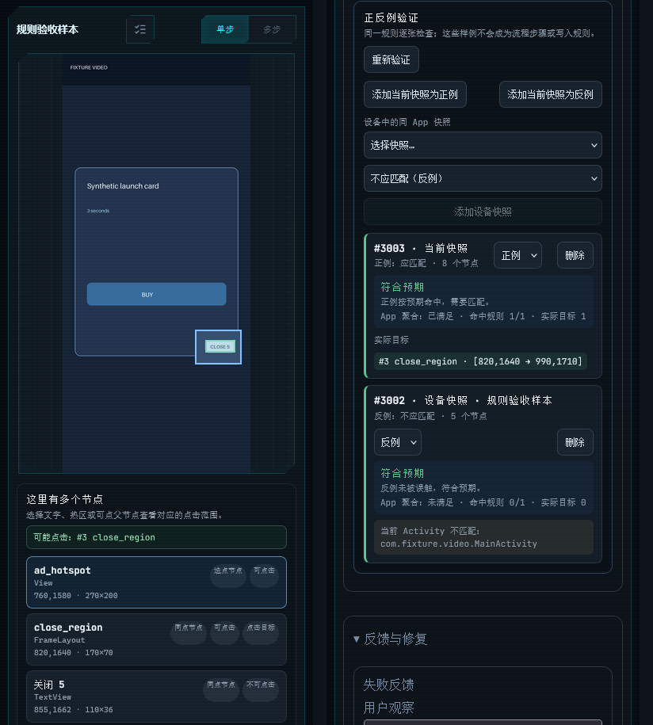

# T03 规则制作浏览器验收

运行目录：仓库根目录；Shell：PowerShell

```powershell
C:\Python314\python.exe scripts/check-rule-authoring.py
```

本轮使用外部设备 HTTP fixture、真实浏览器 pointer 和真实 selector/装配代码；未注入 React state。模拟服务回执不等同 Android 设备验收。

| 检查 | 状态 | 证据 |
| --- | --- | --- |
| 首页设备连接入口可用 | passed | 观察到 HTTP 服务输入框和连接按钮 |
| 外部 fixture 连接并返回三张快照 | passed | getServerInfo 与 getSnapshots 均实际请求 |
| 勾选快照后进入真实截图工作区 | passed | 打开 fixture 快照 3001 |
| 实际 pointer 在截图选中节点并打开选择面板 | passed | 视口坐标 (278,437)；['可点击', '760,1580 · 270×200'] |
| 节点列表可切换目标并更新范围标签 | passed | 真实拖拽命中关闭文字、可点父节点与广告热区；列表显示范围与“点击目标”，切换后 is-picked 同步更新 |
| 规则摘要与点击范围同时可见 | passed | 当前快照命中 1 个点击目标 |
| 候选详情可查看 selector 与复制 JSON5 路径 | passed | 候选卡保持简短；详情可复制，并捕获到含 matches/groups 的完整 AppRule JSON5 |
| fixture 拒绝测试订阅时显示真实错误 | passed | 设备接口错误: updateSubscription 503 |
| 重试后发送完整测试订阅身份 | passed | fixture 收到 id=0、完整 subscription 与规则 |
| 编辑条件输入可验证，取消后保留原候选 | passed | 条件改为不存在文字后显示未命中；取消后编辑器卸载 |
| 应用编辑后的规则并更新候选摘要 | passed | 修改原条件值且应用按钮可用，应用后编辑器卸载 |
| 规则可加入当前快照正例并逐张验证 | passed | details 展开并显示一张正例结果 |
| 取消非首选候选编辑后恢复被编辑候选 | passed | 第二张候选卡进入编辑后取消，候选仍保持激活，已有正例样例未丢失 |
| 同 app 正反例逐张展示 | passed | 正例 #3003 与无关闭节点的反例 #3002 均显示“符合预期” |
| 编辑零命中时保留正反例且取消后恢复规则 | passed | 已有 2 项时编辑为不存在值：应用禁用、正例重算失败但两项保留；取消后两项按原规则恢复通过 |
| 反馈与修复面板可展开并保留修复证据 | passed | 外部剪贴板 seam 捕获到当前规则、close_region 条件、节点不可用分类与修复限制；按钮进入“已复制 prompt” |
| 移动端视口无横向溢出 | passed | 412×915 |

截图：

## Findings

- `multi-snapshot-async-response-dropped`（closed）：MultiSnapshotValidationPanel now uses runRef updated only when appKey changes; fixture #3003 plus #3002 rendered as two passing samples in this run.

## 边界

本记录是浏览器 fixture 行为，不是 Android WebView 或真机验收，也没有证明 GKD 设备执行成功。复制路径通过页面公开的 `window.GkdAndroidBridge.copyToClipboard` seam 捕获 payload，并核对 AppRule JSON5 及反馈分类、条件、修复提示；这是浏览器 seam 验证，不是 Android 系统剪贴板或真机执行验收。
